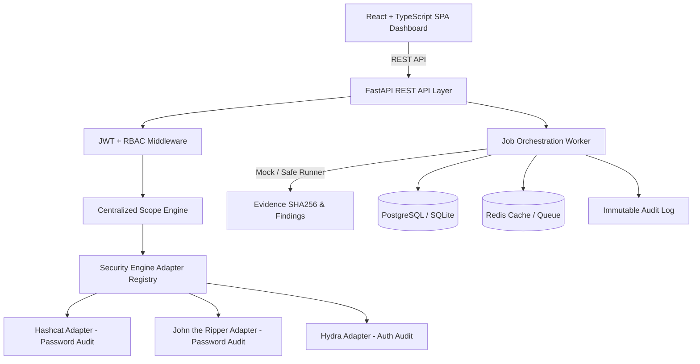

# AegisAudit
Authorized Credential Security Assessment Platform

> **IMPORTANT**: Authorized testing only. AegisAudit is strictly intended for authorized penetration testing laboratories, security engineering assessments, and academic security research. Never execute against unauthorized targets.

---

## What It Is

AegisAudit is a professional cybersecurity assessment platform designed to centralize target-scope enforcement, authorization, background job orchestration, security-engine execution, evidence collection, and security reporting.

By placing a **Centralized Scope Engine** in front of security adapters, AegisAudit ensures that password auditing and authentication testing tools cannot execute against targets outside explicitly authorized networks.

---

## Authorized-Use Notice

This platform must only be used in authorized environments (e.g. penetration-testing laboratories, university capstones, or explicit client-approved assessment scopes). All execution activity is logged to an immutable compliance audit trail.

---

## Current Status

**Status**: MVP / Active Development

The current release focuses on core assessment management, RBAC authorization, target-scope validation, job orchestration, evidence hashing, and modular security-engine adapter architecture.

Enterprise SSO, advanced CI pipelines, and additional engines remain planned for future hardening phases.

---

## Features

### Implemented

✓ User Authentication & Role-Based Access Control (RBAC)  
✓ Centralized Target Scope Validation Engine (Subnet / IP / Domain / Port / Protocol)  
✓ Security Engine Adapter Architecture (Hashcat, John the Ripper, Hydra)  
✓ Asynchronous Background Job Execution & Progress Monitoring  
✓ Safe Demonstration Mock Engine Mode (`MOCK_ENGINE=true`)  
✓ Evidence SHA256 Integrity Hashing & Findings Tracking  
✓ Executive Security Report Generation (Markdown & HTML)  
✓ Immutable Compliance Audit Trail Logging  
✓ Dark Cyber Aesthetic React + TypeScript SPA Dashboard  

### Planned

○ Extended Security Engines (Medusa, Ncrack, CeWL, Crunch, Nmap)  
○ Advanced Wordlist & Rule Set Intelligence  
○ Automated Scope Verification via Port Scanning  
○ Enterprise SSO / OpenID Connect (OIDC) Integration  
○ CI/CD Security Regression Pipeline & Hardening  

---

## Architecture



---

## Project Structure

```text
aegisaudit/
│
├── backend/
│   ├── app/
│   │   ├── api/          # REST API endpoints (Auth, Scope, Assessments, Jobs, Reports, Audit)
│   │   ├── core/         # Scope Validation Engine & Security pipeline
│   │   ├── adapters/     # Security tool adapters (Hashcat, John, Hydra)
│   │   ├── db/           # SQLAlchemy database session & engine
│   │   ├── models/       # ORM models (User, Scope, Assessment, Job, Finding, Evidence, AuditLog)
│   │   ├── schemas/      # Pydantic data validation schemas
│   │   └── services/     # Job execution worker & report generator
│   ├── tests/            # Pytest automated test suite & synthetic fixtures
│   ├── requirements.txt  # Production runtime dependencies
│   ├── requirements-dev.txt # Development & test dependencies
│   ├── pyproject.toml    # Tool configurations (Ruff, Black, MyPy, Pytest)
│   └── Dockerfile        # Backend container image build file
│
├── frontend/
│   ├── src/              # React + TypeScript source code & components
│   ├── public/           # Public static web assets
│   ├── package.json      # Frontend package configuration
│   └── Dockerfile        # Frontend Nginx production container
│
├── docs/
│   ├── architecture.md       # Detailed architecture design guide
│   ├── security-model.md     # Scope engine & security pipeline documentation
│   ├── engine-adapters.md    # Security engine adapter developer guide
│   └── portfolio-description.md # LinkedIn & portfolio project summary
│
├── .github/
│   ├── ISSUE_TEMPLATE/   # GitHub bug and feature report templates
│   └── pull_request_template.md # PR submission checklist
│
├── .editorconfig         # Code style & line ending configuration
├── .gitattributes        # Git text normalization settings
├── .gitignore            # Security exclusion rules (secrets, caches, builds)
├── .env.example          # Safe development environment template
├── README.md             # Project documentation
├── SECURITY.md           # Security policy & reporting guidelines
├── LICENSE               # Project licensing notice
└── docker-compose.yml    # Multi-container local orchestration
```

---

## Quick Start

To launch the full platform using Docker Compose:

```bash
# Clone the repository
git clone <repository-url>
cd aegisaudit

# Copy development environment template
cp .env.example .env

# Build and start services
docker compose up --build
```

Access the services:
- **Frontend Dashboard**: `http://localhost:3000`
- **FastAPI Documentation**: `http://localhost:8000/docs`
- **Health Check Endpoint**: `http://localhost:8000/health`

---

## Local Development

### Backend Setup

```bash
cd backend

# Create and activate virtual environment
python -m venv .venv

# On Linux/macOS
source .venv/bin/activate
# On Windows
.venv\Scripts\activate

# Install dependencies
pip install -r requirements.txt
pip install -r requirements-dev.txt

# Start development server
uvicorn app.main:app --reload --port 8000
```

### Frontend Setup

```bash
cd frontend

# Install node dependencies
npm install

# Start Vite dev server
npm run dev
```

---

## Testing

Run the automated test suite and code quality linters:

```bash
cd backend

# Run backend unit tests
pytest

# Code linter
ruff check .

# Code formatting check
black --check .

# Static type checking
mypy app
```

---

## Engine Matrix

| Engine    | Category           | Status      | Network |    Scope |
| --------- | ------------------ | ----------- | ------: | -------: |
| Hashcat   | Password Audit     | Implemented |      No |      N/A |
| John      | Password Audit     | Implemented |      No |      N/A |
| Hydra     | Authentication     | Implemented |     Yes | Required |
| Medusa    | Authentication     | Planned     |     Yes | Required |
| Ncrack    | Authentication     | Planned     |     Yes | Required |
| CeWL      | Wordlist           | Planned     |     Yes | Required |
| Crunch    | Wordlist           | Planned     |      No |      N/A |
| Pack      | Analysis           | Planned     |      No |      N/A |
| Mentalist | Wordlist           | Planned     |      No |      N/A |
| Hashid    | Identification     | Planned     |      No |      N/A |
| Nmap      | Scope Verification | Planned     |     Yes | Required |

---

## Mock Mode

AegisAudit includes a built-in simulation mode configured via:

```env
MOCK_ENGINE=true
```

Mock mode allows the platform to demonstrate job creation, live progress tracking, result processing, evidence generation, and executive reporting without executing external security tools or transmitting live network traffic.

All simulated results are clearly tagged with:

```text
[DEMO / MOCK]
```

Simulated results are never mixed with real assessment findings.

---

## Security Model

AegisAudit implements a centralized authorization and scope validation pipeline:

```text
Authentication
      ↓
RBAC Authorization (Admin / Auditor / Viewer)
      ↓
Assessment Scope Policy Authorization
      ↓
Engine Allowlist Verification
      ↓
Target Scope Engine Validation
      ↓
Protocol Allowlist Validation
      ↓
Port Allowlist Validation
      ↓
Resource Limits Policy Check
      ↓
Typed Parameter Sanitation (No raw shell strings)
      ↓
Job Execution Queue
      ↓
Isolated Worker Execution
      ↓
Engine Adapter
      ↓
Evidence SHA256 Hash & Security Findings
      ↓
Immutable Audit Log
```

### Core Security Guarantees

* **No arbitrary shell-command execution**: Tool adapters construct explicit argument vectors (`List[str]`).
* **Strict scope isolation**: No network engine may execute against an out-of-scope target.
* **Non-bypassable adapter layer**: Engine adapters cannot bypass centralized authorization policy.

---

## Configuration

Configuration is managed securely via `.env` and `app/config.py`:

| Parameter | Default | Description |
| --------- | ------- | ----------- |
| `APP_NAME` | `AegisAudit` | Application identifier |
| `ENVIRONMENT` | `development` | Runtime environment mode |
| `DATABASE_URL` | `postgresql+psycopg://...` | Database connection string |
| `REDIS_URL` | `redis://redis:6379/0` | Redis queue URL |
| `JWT_SECRET` | `CHANGE_ME_FOR_LOCAL_DEVELOPMENT` | Secret key for JWT signing |
| `MOCK_ENGINE` | `true` | Enable safe simulation mode |
| `MAX_CONCURRENT_JOBS` | `2` | Maximum parallel job execution limit |

---

## Documentation

Comprehensive documentation is available in the `docs/` folder:
- [Architecture Guide](file:///docs/architecture.md)
- [Security Model & Scope Enforcement](file:///docs/security-model.md)
- [Engine Adapters Specification](file:///docs/engine-adapters.md)
- [Portfolio & Presentation Highlights](file:///docs/portfolio-description.md)

---

## Roadmap

### Future Hardening
- GitHub Actions CI/CD workflow
- Automated dependency vulnerability scanning
- Pre-commit hook integration
- Enterprise Single Sign-On (SSO / OIDC)
- Automated Scope Verification via Nmap Integration

---

## License

See [LICENSE](file:///LICENSE) for licensing details.
