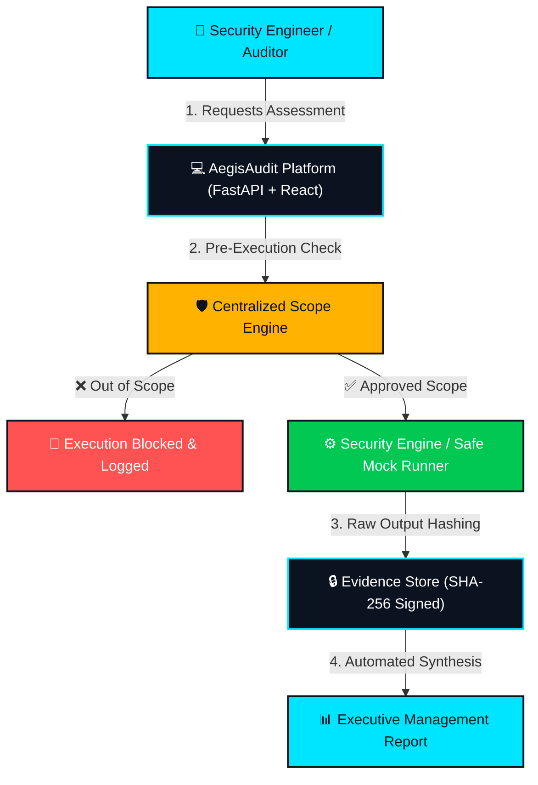
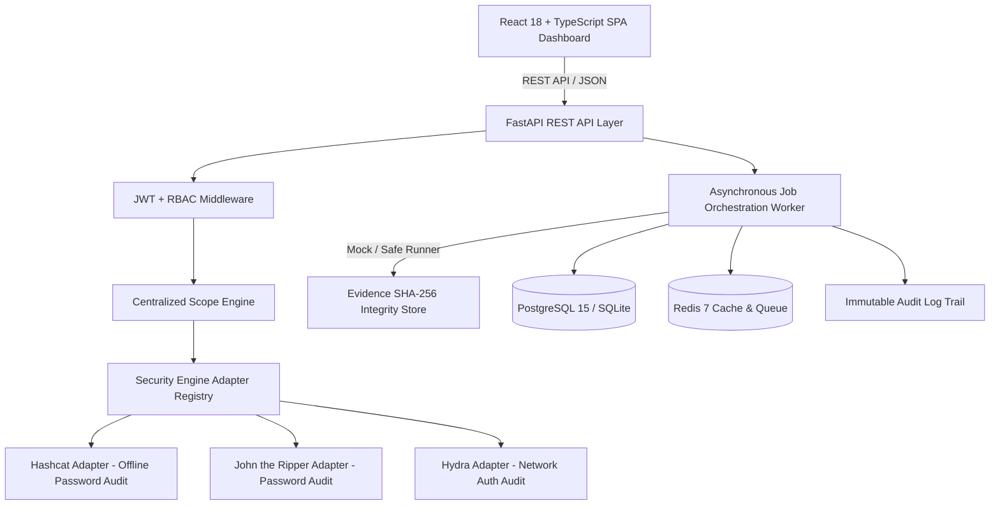

# AegisAudit

<p align="center">
  
  
  
  
  
  
  
  
  
</p>

<p align="center">
  <strong>A safe, controlled, and automated security inspection platform that checks whether passwords and logins are strong — without ever touching unauthorized systems.</strong>
</p>

---

## 📖 What is AegisAudit? (Plain English)

Think of **AegisAudit** like a certified building safety inspector hired to test whether door locks are strong enough to keep out intruders. The inspector is only legally allowed to test locks on the specific doors that the building owner explicitly approved in writing. If the inspector accidentally attempts to open a door to an unauthorized room or neighboring business, an automatic security badge scanner stops them right at the threshold.

AegisAudit does the exact same thing for computer networks and servers. It allows authorized security teams to test whether company passwords, logins, and remote access services are secure against cybercriminals. Most importantly, it enforces an unbypassable **Centralized Scope Engine** that guarantees security tools will never send traffic to unapproved servers, IP addresses, or ports. Everything is run safely, recorded in an immutable audit log for legal proof, and summarized into executive reports that business leaders can immediately act upon.

---

## 💡 Why It Matters

- **Weak Passwords Cause Most Breaches**: Over 80% of confirmed enterprise data breaches trace back to stolen, default, or easily guessable passwords. Regular, automated audits catch these exposures before external attackers find them.
- **Testing Must Be Legal & Controlled**: Running offensive security tools without strict boundaries can crash production systems or violate computer crime laws. AegisAudit enforces non-bypassable scope allowlists so engineers test only authorized assets.
- **Reports Must Be Understandable by Management**: Raw terminal outputs and scanning dumps are useless to business leadership. AegisAudit automatically translates technical results into plain-English risk ratings and remediation steps.

---

## 👥 Who Is It For?

| Role | How They Use AegisAudit | Core Benefit |
| :--- | :--- | :--- |
| **🛡️ Security Engineer** | Launches credential audits using Hashcat, John, and Hydra through typed REST APIs | Eliminates command typos and arbitrary shell injection risks |
| **📋 Compliance Auditor** | Reviews scope policies, inspects immutable audit logs, and validates SHA-256 evidence | Cryptographic proof that all testing remained strictly within legal scope |
| **👔 Manager / Executive** | Reads plain-English reports, high-level severity summaries, and prioritized fixes | Clear insight into business risk without reading raw scanner dumps |
| **🎓 Cybersecurity Student** | Explores real-world credential auditing workflows in safe simulation mode | Hands-on practice with industry tools without legal or network risk |

---

## ⚡ How It Works in 5 Steps

```text
[ 🔐 Step 1: Login ] ──> [ 🎯 Step 2: Set Scope ] ──> [ 🛡️ Step 3: Run Audit ] ──> [ 🔒 Step 4: Seal Evidence ] ──> [ 📊 Step 5: Report ]
  Role-Based Access        Approved Subnets & Ports     Safe Engine / Mock Mode       SHA-256 Tamper-Proof Hash       Executive PDF/HTML
```

1. 🔐 **Step 1: Authenticate with Role-Based Access**: Users log in using role-restricted accounts (Admin, Auditor, or Viewer) so every action is tracked to an authorized individual.
2. 🎯 **Step 2: Define the Authorized Scope**: Administrators define explicit approved boundaries — specific IP ranges (e.g. `10.0.0.0/24`), hostnames, allowed network ports (e.g. `22, 80, 443`), and protocols (`ssh, http, https`).
3. 🛡️ **Step 3: Run Safe, Controlled Tests**: Choose an assessment engine (Hashcat, John the Ripper, Hydra) or use the safe simulation mode (`MOCK_ENGINE=true`). The Centralized Scope Engine verifies targets before execution, immediately rejecting out-of-scope targets.
4. 🔒 **Step 4: Collect Cryptographic Evidence**: Raw scan telemetry is captured and stamped with an immutable SHA-256 integrity hash, guaranteeing chain-of-custody and preventing finding tampering.
5. 📊 **Step 5: Generate Executive Reports**: Export standardized reports in Markdown or HTML detailing executive summaries, finding severities, and actionable remediation instructions.

---

## 🏛️ System Architecture

### 1. Plain-English Workflow (Non-Technical Overview)



### 2. Technical Architecture & Component Interaction



---

## 📚 Plain-English Cybersecurity Glossary

| Term | What It Means in Simple Words |
| :--- | :--- |
| **RBAC** *(Role-Based Access Control)* | A security rulebook that restricts what users can see and do based on their assigned job role (Admin, Auditor, Viewer). |
| **JWT** *(JSON Web Token)* | A secure, tamper-proof digital badge that proves your identity after logging in without storing passwords in the browser. |
| **Scope** | The strict legal and technical boundary defining exactly which computers, networks, and ports you have permission to test. |
| **Adapter** | A software connector that translates standard platform requests into the exact syntax required by different scanning tools. |
| **SHA-256** | A cryptographic digital fingerprint that proves evidence or data has not been altered or tampered with since creation. |
| **Audit Trail** | A permanent, tamper-resistant history log recording who initiated what test, when it occurred, and what happened. |
| **Mock Mode** | A 100% safe simulation mode that mimics realistic security assessments without executing binaries or transmitting network traffic. |
| **Hashcat / John / Hydra** | Industry-standard cybersecurity tools used by ethical hackers to audit password strength (Hashcat/John) and test login portals (Hydra). |

---

## 🛡️ Safety First: Built-in Ethical Guardrails

> [!IMPORTANT]
> ### 🚨 Authorized Testing Only
> AegisAudit is designed strictly for authorized penetration testing laboratories, corporate security engineering assessments, and academic research. Never execute assessments against unauthorized systems.
>
> - **Safe Simulation by Default (`MOCK_ENGINE=true`)**: AegisAudit defaults to simulation mode. You can fully test the UI, create assessments, observe job progress, and generate executive reports without running external tools or sending live network packets.
> - **Centralized Scope Gate**: Network-facing adapters cannot bypass the Scope Engine. Any target IP address or port outside approved CIDR blocks is immediately rejected with `REJECTED_OUT_OF_SCOPE`.
> - **Zero Shell Expansion**: Commands are constructed as explicit argument vectors (`List[str]`). Shell string evaluation (`shell=True`) is strictly prohibited.
> - **Forensic Non-Repudiation**: Raw execution output is hashed with SHA-256 immediately upon completion and linked to an immutable compliance audit record.

---

## 📸 Screenshots & UI Walkthrough

*(High-resolution screenshots are stored in [docs/images/](docs/images/))*

| View | Screenshot Preview | What It Shows |
| :--- | :--- | :--- |
| **Dashboard Overview** |  | High-level assessment statistics, active jobs, engine availability matrix, and quick-action shortcuts. |
| **Scope Policy Rules** |  | Authorized target CIDR ranges (`10.0.0.0/24`), allowed port lists (`22, 80, 443`), and protocol allowlists. |
| **Live Job Monitor** |  | Asynchronous execution tracking, live progress bar, engine telemetry, and safe `[DEMO / MOCK]` status tagging. |
| **Executive Report** |  | Formatted audit report with vulnerability severity ratings (Critical, High, Medium, Low), SHA-256 evidence hashes, and remediation guidance. |

---

## 💼 Skills Demonstrated (For Recruiters & Hiring Managers)

- **Secure-by-Design API Architecture**: Designed a modular FastAPI backend with Pydantic v2 schemas, strict input validation, and defensive programming that completely avoids arbitrary command execution.
- **Granular RBAC & Session Security**: Implemented JWT authorization middleware with salted bcrypt password hashing and tiered permission enforcement (Admin, Auditor, Viewer).
- **Asynchronous Task Orchestration**: Built reliable background job orchestration with explicit state transitions (`queued` → `running` → `completed` / `rejected_out_of_scope`).
- **Forensic Chain-of-Custody**: Implemented automatic SHA-256 integrity hashing on all raw assessment outputs to guarantee evidence authenticity.
- **Containerization & Health Orchestration**: Multi-container Docker Compose configuration featuring health checks for backend, PostgreSQL, and Redis with seamless dependency gating.
- **Automated Testing & Code Quality**: 100% passing test suite across Pytest, strict MyPy type checking (`--disallow-untyped-defs`), Ruff linting, and Black formatting.
- **CI/CD & DevSecOps Automation**: GitHub Actions CI pipeline running automated linting, formatting verification, type checks, test coverage, and React frontend builds on every pull request.

---

## ⏱️ Demo in 2 Minutes (Copy-Paste Quick Start)

Experience AegisAudit locally in safe simulation mode in under 2 minutes:

```bash
# 1. Clone the repository
git clone https://github.com/[YOUR_USERNAME]/aegisaudit.git
cd aegisaudit

# 2. Copy the safe development environment configuration
cp .env.example .env

# 3. Launch the full platform (Backend, Frontend, Postgres, Redis)
docker compose up --build -d
```

### Accessing the Platform

- **🖥️ Web Dashboard**: Open [http://localhost:3000](http://localhost:3000)
- **📚 Interactive API Documentation (Swagger)**: Open [http://localhost:8000/docs](http://localhost:8000/docs)
- **❤️ API Health Check**: Open [http://localhost:8000/health](http://localhost:8000/health)

### 🔑 Demo Accounts (Pre-Seeded & Ready)

The database automatically initializes with three role-based demonstration accounts:

| Role | Username | Demo Password | Capabilities |
| :--- | :--- | :--- | :--- |
| **Admin** | `admin` | `DemoAdmin2026!` | Full administrative control: manage users, scopes, assessments, and audit logs |
| **Auditor** | `auditor` | `DemoAuditor2026!` | Assessment operator: create scopes, launch assessment jobs, generate reports |
| **Viewer** | `viewer` | `DemoViewer2026!` | Stakeholder / Read-only: inspect completed assessments and read executive reports |

### Quick Walkthrough Steps

1. Log in at `http://localhost:3000` with username `admin` and password `DemoAdmin2026!`.
2. Navigate to **Scopes** to view the pre-configured *Internal Lab Network Scope* (`10.0.0.0/24`).
3. Navigate to **Assessments**, click **New Assessment**, set target to `10.0.0.15` and engine to `Hydra`.
4. Click **Launch Job**. Watch the live job progress monitor complete the simulated assessment safely.
5. Navigate to **Reports** and generate an executive Markdown or HTML report!

---

## 🛠️ Security Engine Matrix

| Engine | Category | Status | Network | Scope Validation | Description |
| :--- | :--- | :---: | :---: | :---: | :--- |
| **Hashcat** | Password Audit | ✅ Implemented | No | N/A | GPU-accelerated dictionary & ruleset password recovery |
| **John the Ripper** | Password Audit | ✅ Implemented | No | N/A | Multi-algorithm offline credential security testing |
| **Hydra** | Authentication | ✅ Implemented | Yes | 🛡️ Required | Network authentication audit (SSH, HTTP, FTP, RDP) |
| **Medusa** | Authentication | ⏳ Planned | Yes | 🛡️ Required | Parallelized network authentication assessment |
| **Ncrack** | Authentication | ⏳ Planned | Yes | 🛡️ Required | High-speed network authentication testing engine |
| **CeWL** | Wordlist Gen | ⏳ Planned | Yes | 🛡️ Required | Custom wordlist generation via target spidering |
| **Crunch** | Wordlist Gen | ⏳ Planned | No | N/A | Wordlist generation based on character sets & patterns |
| **Pack** | Analysis | ⏳ Planned | No | N/A | Password analysis and advanced mask generation |
| **Mentalist** | Wordlist Gen | ⏳ Planned | No | N/A | Graphical wordlist manipulation and ruleset builder |
| **Hashid** | Identification | ⏳ Planned | No | N/A | Hash algorithm identification and entropy analysis |
| **Nmap** | Verification | ⏳ Planned | Yes | 🛡️ Required | Automated pre-assessment scope and open port verification |

---

<details>
<summary><strong>🐧 Running on Kali Linux (Direct Tool Integration)</strong></summary>

### Option A: Docker Deployment on Kali (Recommended)

```bash
# 1. Install Docker & Compose on Kali
sudo apt update && sudo apt install -y docker.io docker-compose-v2
sudo systemctl enable --now docker
sudo usermod -aG docker $USER

# 2. Clone and start AegisAudit
git clone https://github.com/[YOUR_USERNAME]/aegisaudit.git
cd aegisaudit
cp .env.example .env
docker compose up --build -d
```

### Option B: Native Deployment (Direct Kali Tool Integration)

To connect AegisAudit directly to native Kali binaries (`hashcat`, `john`, `hydra`, and `rockyou.txt`):

```bash
# 1. Install prerequisites and extract wordlists
sudo apt update
sudo apt install -y python3-venv python3-pip nodejs npm hashcat john hydra wordlists
sudo gzip -d /usr/share/wordlists/rockyou.txt.gz 2>/dev/null || true

# 2. Clone and prepare configuration
git clone https://github.com/[YOUR_USERNAME]/aegisaudit.git
cd aegisaudit
cp .env.example .env

# 3. Enable real tool execution in .env
sed -i 's/MOCK_ENGINE=true/MOCK_ENGINE=false/g' .env

# 4. Start the Backend API
cd backend
python3 -m venv .venv
source .venv/bin/activate
pip install -r requirements.txt
uvicorn app.main:app --host 0.0.0.0 --port 8000 --reload &

# 5. Start the Frontend SPA
cd ../frontend
npm install
npm run dev
```

</details>

---

<details>
<summary><strong>💻 Local Development & Testing Instructions</strong></summary>

### Backend Setup (Standalone Python)

```bash
cd backend

# Create virtual environment
python -m venv .venv

# Activate environment
# On Linux / macOS:
source .venv/bin/activate
# On Windows PowerShell:
.\.venv\Scripts\Activate.ps1

# Install dependencies
pip install -r requirements.txt
pip install -r requirements-dev.txt

# Run all quality checks
ruff check .
black --check .
mypy app
pytest -v --cov=app --cov-report=term-missing
```

### Frontend Setup (Vite + React)

```bash
cd frontend

# Install dependencies
npm install

# Run development server
npm run dev

# Run TypeScript compilation and production build
npm run build
```

### Automation via Makefile

```bash
make up      # Start stack via Docker Compose
make down    # Stop stack
make test    # Run backend test suite
make lint    # Run Ruff, Black, and MyPy
make format  # Auto-format Python code
make seed    # Seed demo users & sample scopes
make demo    # Launch stack, seed users, and print demo instructions
```

</details>

---

<details>
<summary><strong>⚙️ Configuration Parameters (.env & app/config.py)</strong></summary>

| Parameter | Type | Default | Description |
| :--- | :---: | :--- | :--- |
| `APP_NAME` | string | `AegisAudit` | Application identifier |
| `ENVIRONMENT` | string | `development` | Runtime mode (`development`, `staging`, `production`) |
| `LOG_LEVEL` | string | `INFO` | Logging level (`DEBUG`, `INFO`, `WARNING`, `ERROR`) |
| `DATABASE_URL` | string | `postgresql+psycopg://...` | Database connection string (PostgreSQL or SQLite) |
| `REDIS_URL` | string | `redis://redis:6379/0` | Redis queue and cache connection URL |
| `JWT_SECRET` | string | `CHANGE_ME_...` | Cryptographic secret for signing JWT tokens *(refuses to start in production if unchanged)* |
| `JWT_ALGORITHM` | string | `HS256` | JWT signature algorithm |
| `ACCESS_TOKEN_EXPIRE_MINUTES` | int | `30` | JWT token lifespan in minutes |
| `CORS_ORIGINS` | string | `http://localhost:3000,...` | Comma-separated list of permitted web origins |
| `MOCK_ENGINE` | bool | `true` | Safe simulation mode *(default: true)* |
| `HASHCAT_PATH` | string | `/usr/bin/hashcat` | Absolute path to Hashcat binary |
| `JOHN_PATH` | string | `/usr/sbin/john` | Absolute path to John the Ripper binary |
| `HYDRA_PATH` | string | `/usr/bin/hydra` | Absolute path to Hydra binary |
| `WORDLIST_PATH` | string | `/usr/share/wordlists/rockyou.txt` | Default path to dictionary wordlist |
| `MAX_CONCURRENT_JOBS` | int | `2` | Maximum concurrent background execution threads |
| `JOB_TIMEOUT_SECONDS` | int | `1800` | Maximum job execution lifespan (30 minutes) |
| `MAX_WORDLIST_SIZE_MB` | int | `1024` | Wordlist file size constraint (1 GB) |
| `VITE_API_URL` | string | `http://localhost:8000` | Backend API base URL for frontend SPA |

</details>

---

## 📁 Repository Structure

```text
aegisaudit/
├── backend/
│   ├── app/
│   │   ├── api/          # REST API endpoints (Auth, Scope, Assessments, Jobs, Findings, Reports, Audit, Engines)
│   │   ├── core/         # Centralized Scope Engine & security pipeline
│   │   ├── adapters/     # Modular security adapters (Hashcat, John, Hydra, Registry)
│   │   ├── db/           # SQLAlchemy database session & engine
│   │   ├── models/       # ORM models (User, Scope, Assessment, Job, Finding, Evidence, AuditLog)
│   │   ├── schemas/      # Pydantic v2 data validation & response schemas
│   │   └── services/     # Job execution worker & executive report generator
│   ├── scripts/          # Standalone seed script (seed.py) for demo accounts
│   ├── tests/            # Pytest test suite & synthetic fixtures
│   ├── requirements.txt  # Production runtime dependencies
│   ├── requirements-dev.txt # Development & testing dependencies
│   ├── pyproject.toml    # Tool configurations (Ruff, Black, MyPy, Pytest, Coverage)
│   └── Dockerfile        # Backend container build file
│
├── frontend/
│   ├── src/              # React 18 + TypeScript source code & components
│   ├── package.json      # Frontend package configuration
│   └── Dockerfile        # Frontend Nginx production container
│
├── docs/
│   ├── architecture.md       # Detailed technical architecture design guide
│   ├── security-model.md     # Scope validation engine & security pipeline guide
│   ├── engine-adapters.md    # Security engine adapter developer specification
│   ├── portfolio-description.md # LinkedIn announcements & resume bullet points
│   └── images/               # Application UI screenshots & previews
│
├── resume/
│   ├── resume.html       # ATS-friendly 1-page modern styled resume (Print to PDF)
│   ├── resume.md         # Plain text Markdown version for ATS scrapers
│   └── README.md         # 5 actionable tips for tailoring resume to cybersecurity roles
│
├── .github/
│   ├── workflows/ci.yml  # GitHub Actions CI pipeline (Ruff, Black, MyPy, Pytest, Build)
│   ├── dependabot.yml    # Automated dependency vulnerability scanning
│   ├── ISSUE_TEMPLATE/   # Issue reporting templates
│   └── pull_request_template.md # PR submission checklist
│
├── .pre-commit-config.yaml # Git pre-commit hooks (Ruff, Black, large-file check)
├── Makefile              # Automation targets (up, down, test, lint, demo, seed)
├── docker-compose.yml    # Multi-container local orchestration with health checks
├── .editorconfig         # Code formatting standards
├── .gitignore            # Security exclusion rules
├── .env.example          # Safe development environment template
├── SECURITY.md           # Security policy & reporting guidelines
├── LICENSE               # MIT Open Source License
└── README.md             # Project documentation (this file)
```

---

## 🔧 Troubleshooting

<details>
<summary><strong>Common Issues & Fixes</strong></summary>

### Docker Compose "panic: slice bounds out of range" crash

If `docker compose build` or `docker compose up --build` crashes with:

```
panic: runtime error: slice bounds out of range [1:0]
```

**Root cause:** A bug in Docker Compose's BuildKit Bake integration (affects Compose v2.30–v2.32).

**Permanent fix — upgrade Docker Compose:**

```bash
# Check your current version
docker compose version

# Update to the latest stable release
sudo apt update && sudo apt install -y docker-compose-v2
# Or install manually:
# sudo curl -SL https://github.com/docker/compose/releases/latest/download/docker-compose-linux-x86_64 \
#   -o /usr/local/lib/docker/cli-plugins/docker-compose
# sudo chmod +x /usr/local/lib/docker/cli-plugins/docker-compose
```

**Temporary workaround (if you cannot upgrade):**

```bash
sudo env COMPOSE_BAKE=false docker compose up --build -d
```

> Note: `COMPOSE_BAKE=false` prints a deprecation warning. Upgrading Compose is the proper fix.

### Missing frontend/package-lock.json

If `npm ci` fails because `package-lock.json` is missing:

```bash
cd frontend
npm install          # generates package-lock.json
npm ci               # clean reproducible install
npm run build        # TypeScript check + Vite production build
```

### Backend module not found errors in pytest

If pytest fails with `ModuleNotFoundError: No module named 'app'`, ensure `pythonpath` is set in `pyproject.toml`:

```toml
[tool.pytest.ini_options]
pythonpath = ["."]
```

### Prerequisites checklist

```bash
# Install system dependencies (Kali / Debian / Ubuntu)
sudo apt update
sudo apt install -y docker.io docker-compose-v2 nodejs npm python3-venv python3-pip git

# Add your user to the docker group (avoids needing sudo for docker)
sudo usermod -aG docker $USER && newgrp docker

# Copy the environment configuration
cp .env.example .env
```

### Quick start commands

```bash
# Build and start all services
docker compose up --build -d

# Check service status
docker compose ps

# Verify endpoints
curl http://localhost:8000/health   # Backend health check
curl http://localhost:3000          # Frontend dashboard

# View logs if a service fails
docker compose logs backend
docker compose logs frontend

# Stop everything
docker compose down
```

### Running checks locally (without Docker)

```bash
# Backend
cd backend
python -m venv .venv
source .venv/bin/activate          # Linux/macOS
pip install -r requirements.txt
pip install -r requirements-dev.txt
ruff check . && black --check . && mypy app && pytest

# Frontend
cd frontend
npm ci
npm run build
npm audit
```

</details>

---

## 📚 Technical Documentation Links

Deep dive into the architecture and security design:

- 🏛️ [Architecture Design Guide](docs/architecture.md)
- 🛡️ [Security Model & Scope Enforcement](docs/security-model.md)
- 🔌 [Security Engine Adapter Specification](docs/engine-adapters.md)
- 💼 [Portfolio & Career Presentation Guide](docs/portfolio-description.md)

---

## 📄 License

This project is licensed under the terms of the MIT License. See [LICENSE](LICENSE) for details.
