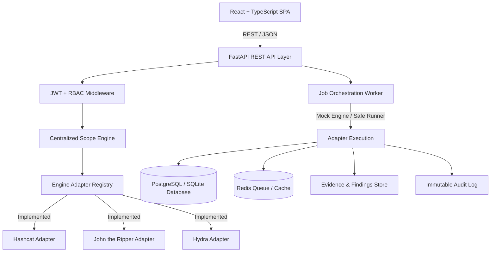

# AegisAudit — Architecture Documentation

## System Overview

AegisAudit is a modular, authorized credential security assessment platform designed to orchestrate security evaluation tasks while strictly enforcing scope boundaries, authorization policy, and evidence traceability.

---

## High-Level Component Diagram

---

## Backend Subsystems

1. **API Layer (`app/api/`)**: FastAPI endpoints structured into modular routers (Auth, Scope, Assessments, Jobs, Findings, Reports, Audit, Engines).
2. **Scope Validation Engine (`app/core/scope_engine.py`)**: Subnet, IP address, CIDR range, domain name, port, and protocol checker.
3. **Engine Adapter Architecture (`app/adapters/`)**: Polymorphic adapter pattern encapsulating security tool argument construction, scope verification, output parsing, and safe mock mode output generation.
4. **Job Execution Worker (`app/services/job_runner.py`)**: Asynchronous worker running assessment tasks, updating job state, hashing raw execution evidence with SHA256, and recording audit events.
5. **Executive Report Generator (`app/services/report_generator.py`)**: Generates Markdown and HTML audit reports for stakeholders.
